<div align="center">



**Computer Science @ SCU · Colombo, Sri Lanka · Open to QA / SDET internships**

[](https://www.linkedin.com/in/gihan-hemachandra-2b3a8026a/)
[](https://x.com/gihan_hema)
[](mailto:prabhashwaragihan@gmail.com)

</div>

---

### ⚙️ `gihan.config.ts` — profile at a glance

```ts
import { defineConfig } from "@gihan/profile";

export default defineConfig({
  name: "Gihan Hemachandra",
  role: "QA Engineer / SDET",
  location: "Colombo, Sri Lanka",
  education: "BSc Computer Science — SCU",

  focus: [
    "Web & API test automation",
    "Test design and quality strategy",
    "AI / ML applied to software testing",
  ],

  projects: ["sauceDemo-QA", "leakscan", "kumana-web", "smart-wallet"],

  use: {
    trace: "on-first-retry",
    screenshot: "only-on-failure",
    reporting: "detailed, evidence-based",
  },

  openTo: ["QA Intern", "Junior QA Engineer", "SDET Intern"],
});
```

---

### 🧪 Featured work — `projects.spec.ts`

> Selected projects, presented as a test run — each one is live on GitHub

| Status | Project | Description | Stack |
|:------:|---------|-------------|-------|
| ✅ `passed` | **[SauceDemo QA Suite](https://github.com/zeexz/SauceDemo-QA-Suite)** | End-to-end quality assurance project for saucedemo.com, covering the complete shopping flow | Playwright · E2E · UI Testing |
| ✅ `passed` | **[leakscan](https://github.com/zeexz/leakscan)** | Fast, local-first CLI for detecting leaked secrets, API keys and credentials across files, Git history and environment variables | Go · CLI · Security |
| ✅ `passed` | **[Kumana Safari Web](https://github.com/zeexz/kumana-safari-web)** | Commercial website built and maintained in production for a safari tour business — [gokumana.com](https://gokumana.com) | HTML · CSS · JS · GitHub Pages |
| ✅ `passed` | **[Smart Wallet](https://github.com/zeexz/Smart-Wallet)** | Personal finance tracker for managing income, expenses and budgets | JavaScript · Finance |

<details>
<summary><b>📋 Professional summary</b></summary>

<br>

Computer Science student at SCU, based in Colombo, specialising in quality engineering.
I work across manual testing fundamentals, test design, and automation for web and APIs,
and I am applying machine learning to practical testing problems — including flaky-test
detection, visual regression, and test-case generation.

My goal is a QA Engineer / SDET role where testing is treated as engineering:
risk-based, measurable, and built into the delivery process from the start.

</details>

<details>
<summary><b>🔍 My approach to testing</b></summary>

<br>

1. **Understand the risk first** — prioritise what would affect users most, not just what is easy to automate
2. **Design before automating** — test cases, boundaries, and negative paths come before code
3. **Automate the regression, explore the unknown** — automation for repeatability, exploratory testing for discovery
4. **Measure the suite** — pass rate, run time, and flakiness are tracked, not assumed
5. **Document findings clearly** — precise steps, expected vs. actual results, and supporting evidence

</details>

---

### 🛠️ Technical skills

<div align="center">

[](https://github.com/zeexz)

</div>

| Area | Tools & technologies |
|------|----------------------|
| **Quality Engineering** | Test Planning · Test Case Design · Bug Reporting · Regression Testing · Exploratory Testing |
| **Test Automation** | Playwright · Selenium · REST Assured · Postman · GitHub Actions (CI) · Page Object Model |
| **AI / Machine Learning** | Python · pandas · scikit-learn · Data Preprocessing · Model Evaluation |
| **Languages** | Java · Python · JavaScript · Go · Kotlin |

---

### 📊 GitHub activity

<div align="center">


</div>

---

<div align="center">

**Open to QA / SDET opportunities — I welcome a conversation about testing, automation, or ML.**

[LinkedIn](https://www.linkedin.com/in/gihan-hemachandra-2b3a8026a/) · [X / @gihan_hema](https://x.com/gihan_hema) · [Email](mailto:prabhashwaragihan@gmail.com)

</div>
